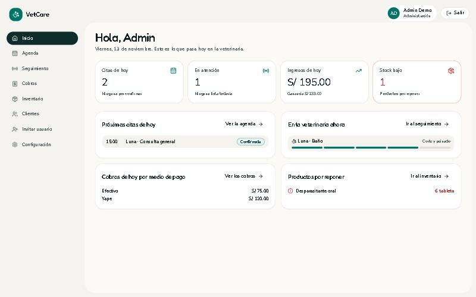
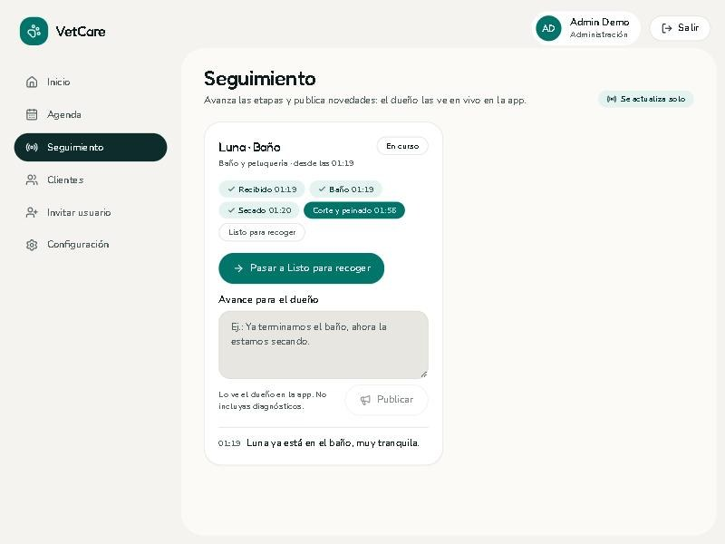
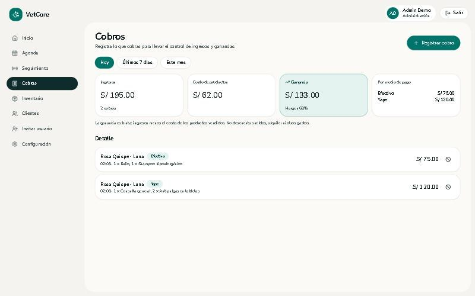
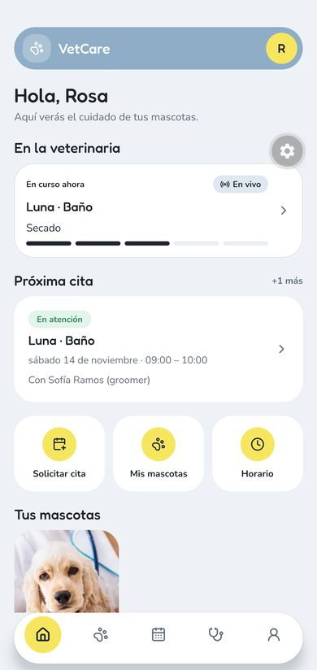
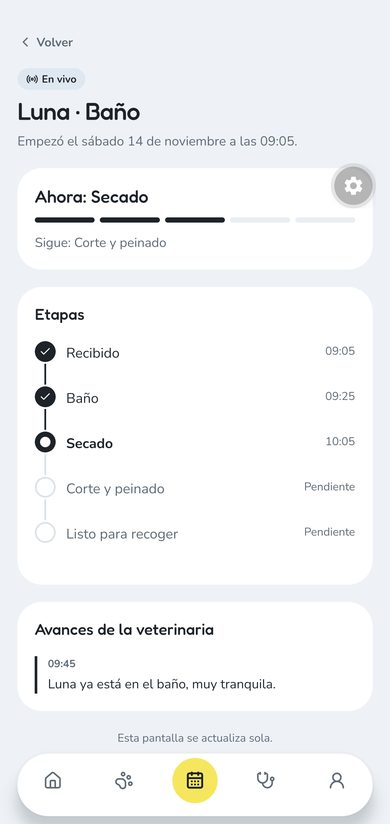
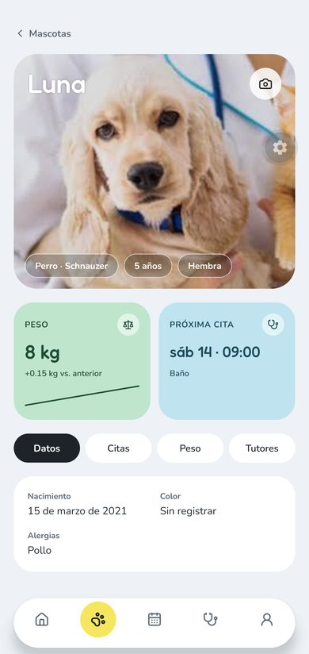
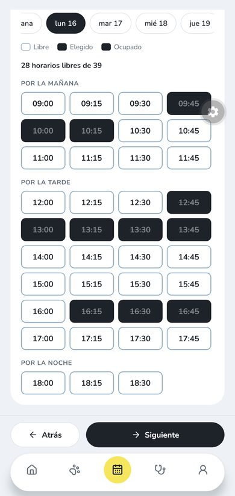
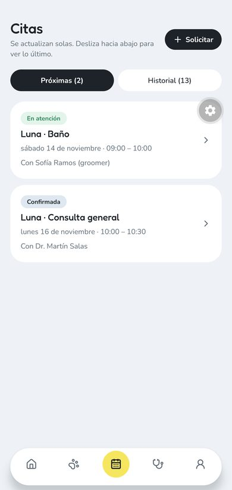
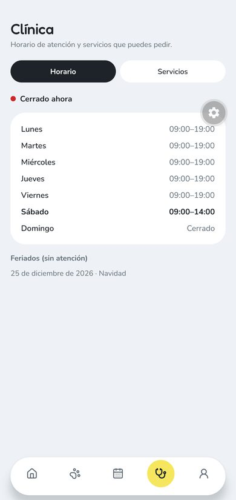
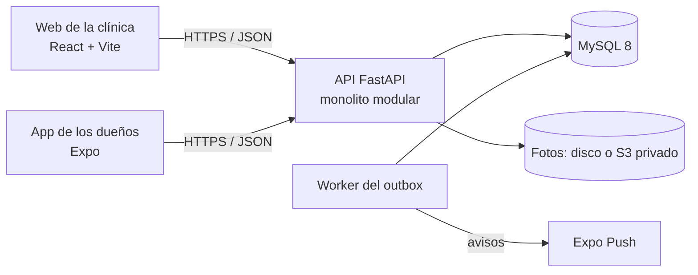

# VetCare 🐾

**Plataforma de gestión para una veterinaria**: una web para el personal y una app para los
dueños de mascotas, conectadas a una API común. El dueño pide citas con su veterinario de
confianza, ve **en vivo** cómo avanza el baño o la cirugía de su mascota y recibe un aviso cuando
está lista. La clínica maneja su agenda, sus clientes, el inventario y los cobros, con la
ganancia del día a la vista.


## Web de la clínica



<p align="center">
  
  
</p>

## App de los dueños

<p align="center">
  
  
  
</p>
<p align="center">
  
  
  
</p>

## Qué hace

**Para el dueño (app móvil)**

- **Seguimiento en vivo**: cada etapa del baño o la cirugía (recibido, baño, secado… alta
  autorizada) con su hora y los avances que publica la clínica, sin recargar.
- **Citas**: elige el servicio, su **veterinario de confianza** y la hora en una grilla tipo
  sala de cine (los horarios ocupados se ven oscuros); reprograma o cancela con la antelación
  mínima.
- **Avisos push** cuando la clínica confirma, reprograma o cancela, cuando empieza la atención y
  cuando la mascota está lista para recoger.
- **Perfil de cada mascota**: foto, edad, peso con su evolución, alergias y responsables.

**Para la clínica (web)**

- **Panel del día**: citas de hoy, mascotas en atención y listas para recoger, ingresos y
  ganancia, productos por reponer.
- **Agenda** por profesional con reservas sin superposiciones, confirmación, llegada y cierre.
- **Tablero de seguimiento** para avanzar etapas y publicar novedades al dueño; el alta de una
  cirugía solo la autoriza un veterinario.
- **Clientes y mascotas** en un catálogo con búsqueda, alergias a la vista y responsables
  autorizados con permisos.
- **Inventario** con costo, precio, margen y stock mínimo, y **cobros registrados** (efectivo,
  tarjeta, Yape, Plin, transferencia) que descuentan stock y calculan la ganancia.
- **Configuración** de servicios, recursos (veterinarios, groomers, salas), horario y feriados.

## Lo técnico que vale la pena mirar

- **Monolito modular con arquitectura hexagonal** por *bounded context* (identidad, clínica,
  clientes, agenda, seguimiento, notificaciones, ventas). Las reglas de dependencia entre capas y
  contextos se verifican con pruebas ([ADR 0001](docs/adr/0001-monolito-modular.md),
  [ADR 0002](docs/adr/0002-arquitectura-hexagonal-ddd.md)).
- **Reservas sin conflictos**: bloqueo por recurso dentro de la transacción, `Idempotency-Key` y
  pruebas de reservas simultáneas contra MySQL real.
- **Outbox transaccional y worker propio**: los eventos se guardan en la misma transacción que el
  cambio y un worker los entrega con deduplicación y reintentos exponenciales
  ([ADR 0003](docs/adr/0003-outbox-transaccional.md)); así salen los avisos push por Expo.
- **Contratos tipados de punta a punta**: los tipos TypeScript de la web y la app se generan del
  OpenAPI de la API y el CI impide fusionar un cambio sin regenerarlos.
- **Seguridad**: roles y permisos explícitos verificados en el backend, aislamiento entre
  clientes por tutela, refresh tokens rotativos con detección de reutilización, fotos en
  almacenamiento privado con URLs firmadas y avisos push sin datos clínicos
  ([seguridad](docs/security/README.md)).
- **Calidad**: más de 520 pruebas (394 de la API, incluidas las de integración contra MySQL; 93
  de la web; 35 de la app) y un recorrido E2E con Playwright. CI por área con ruff, mypy
  estricto, ESLint, Prettier y commitlint.



## Stack

| Parte | Tecnologías |
|---|---|
| [`apps/api`](apps/api/README.md) | Python 3.12, FastAPI, SQLAlchemy 2.0 (async), Alembic, Pydantic v2, MySQL 8 |
| [`apps/web`](apps/web/README.md) | React, TypeScript, Vite, React Router, TanStack Query, React Hook Form + Zod, Tailwind + shadcn/ui, FullCalendar |
| [`apps/mobile`](apps/mobile/README.md) | React Native, Expo SDK 58, Expo Router, TanStack Query, Expo Notifications, SecureStore |
| [`packages/shared`](packages/shared/README.md) | Tipos TypeScript generados desde OpenAPI |
| Infraestructura | Docker Compose, GitHub Actions (API, web, móvil, contratos, E2E, commitlint) |

## Probarlo en local

Requiere Docker y Node 22. En `.env` cambia las claves de MySQL y `VETCARE_JWT_SECRET`.

```bash
cp .env.example .env
docker compose up -d --build
docker compose run --rm api alembic upgrade head
docker compose exec api python -m vetcare.cli create-admin --email admin@ejemplo.test --name "Tu Nombre"
```

En local el correo se escribe en la consola: el enlace para activar al administrador aparece en
`docker compose logs api`. Después, un solo comando carga una veterinaria en marcha (40 clientes
con sus mascotas, citas de un mes, seguimientos en curso, inventario y cobros):

```bash
docker compose exec api python -m vetcare.cli seed-demo
```

```bash
npm install
cp apps/web/.env.example apps/web/.env.local
npm run web:dev        # web en http://localhost:5173
npm run mobile:start   # app en Expo Go, emulador o simulador
```

Más detalle en [docs/development/README.md](docs/development/README.md).

## Funcionalidades por fase

| Módulo | Estado | Fase |
|---|---|---|
| Autenticación, roles y permisos | API, web y app móvil | 1 |
| Configuración de la clínica (servicios, recursos, horarios) | API y web | 2 |
| Clientes, mascotas y responsables autorizados | API, web y app móvil | 2 |
| Agenda y citas sin conflictos | API, web y app móvil | 2 |
| Seguimiento de baños, peluquería y cirugías | API, web y app móvil | 3 |
| Avisos push y actualización en vivo (cada 10 s) | API y app móvil; SSE pendiente | 3 |
| Inventario, cobros registrados y ganancias | API y web | 5–6 (adelantado) |
| Historial clínico, tratamientos y recordatorios | Pendiente | 4 |
| Presupuestos, comprobantes internos, lotes y vencimientos | Pendiente | 5–6 |

Ver la [hoja de ruta](docs/roadmap.md) y el [CHANGELOG](CHANGELOG.md).

## Documentación

- [Arquitectura](docs/architecture/overview.md) · [Dominio](docs/domain/bounded-contexts.md) ·
  [Decisiones (ADR)](docs/adr/README.md)
- [API](docs/api/README.md) · [Seguridad y privacidad](docs/security/README.md) ·
  [Pruebas](docs/testing/README.md)
- [Sistema de diseño](docs/design/README.md) · [Cómo contribuir](CONTRIBUTING.md)

## Contexto

- Pensada para una veterinaria de una sede en Perú: interfaz en español, hora de
  `America/Lima` y montos en soles (S/).
- Los cobros se **registran**; la plataforma no procesa pagos ni emite comprobantes tributarios
  (la integración con SUNAT y pasarelas de pago queda para una fase posterior).
- Los datos de las capturas son ficticios, generados con `seed-demo`.
