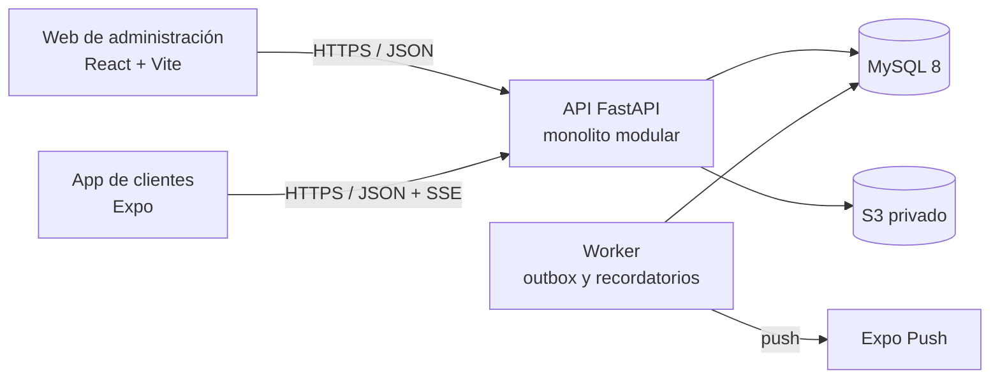

# VetCare — Plataforma de Gestión Veterinaria

Plataforma para una veterinaria de una sede: una **web de administración** para el personal
(recepción, veterinarios, asistentes, administración) y una **app móvil** para los dueños y
responsables autorizados de las mascotas, conectadas a una **API común**.

> **Estado actual: v0.1.0, fase 1 (fundamentos) completada.** La API tiene su base técnica y la
> autenticación con roles y permisos; la web de administración tiene su base (sesión,
> navegación por permisos e invitación de usuarios) y la app móvil de clientes la suya (sesión
> segura y pantallas de acceso).
> La tabla de abajo se actualiza en cada entrega.

## Funcionalidades

| Módulo | Estado | Fase |
|---|---|---|
| Autenticación, roles y permisos | API, web y app móvil implementadas | 1 |
| Clientes, mascotas y responsables autorizados | Planificado | 2 |
| Agenda y citas sin conflictos | Planificado | 2 |
| Seguimiento de baños y peluquería | Planificado | 3 |
| Seguimiento de cirugías | Planificado | 3 |
| Seguimiento en tiempo real (SSE) y notificaciones push | Planificado | 3 |
| Historial clínico, tratamientos y recordatorios | Pendiente (fuera del MVP) | 4 |
| Presupuestos, pagos y comprobantes internos | Pendiente (fuera del MVP) | 5 |
| Inventario, lotes y vencimientos | Pendiente (fuera del MVP) | 6 |

El MVP comprende las fases 0 a 3. Ver [docs/roadmap.md](docs/roadmap.md).

## Arquitectura

Monolito modular con arquitectura hexagonal por *bounded context*. Ver
[docs/architecture/overview.md](docs/architecture/overview.md) y [docs/domain/](docs/domain/).



## Stack

| Parte | Tecnologías |
|---|---|
| `apps/api` | Python 3.12, FastAPI, SQLAlchemy 2.0, Alembic, Pydantic v2, MySQL 8 |
| `apps/web` | React, TypeScript, Vite, React Router, TanStack Query, React Hook Form + Zod, Tailwind + shadcn/ui, FullCalendar |
| `apps/mobile` | React Native, Expo, Expo Router, TanStack Query, Expo Notifications, SecureStore |
| `packages/shared` | Tipos TypeScript generados desde OpenAPI |
| Infraestructura | Docker Compose (local), AWS EC2 + RDS + S3, GitHub Actions |

## Contratos compartidos

La web y la app móvil consumen la API con los tipos de [`packages/shared`](packages/shared/README.md),
generados desde el contrato OpenAPI. El CI impide fusionar un cambio de la API sin actualizarlos.

## Inicio rápido

```bash
bash scripts/setup-hooks.sh
cp .env.example .env
docker compose up --build
```

Luego aplica las migraciones y crea el primer administrador como se explica en
[docs/development/README.md](docs/development/README.md).

## Documentación

- [Arquitectura](docs/architecture/overview.md)
- [Sistema de diseño](docs/design/README.md)
- [Dominio y bounded contexts](docs/domain/bounded-contexts.md)
- [Decisiones de arquitectura (ADR)](docs/adr/README.md)
- [API](docs/api/README.md)
- [Seguridad y privacidad](docs/security/README.md)
- [Estrategia de pruebas](docs/testing/README.md)
- [Hoja de ruta](docs/roadmap.md)
- [Cómo contribuir](CONTRIBUTING.md)

## Contexto operativo

- Interfaz en español (Perú), zona horaria `America/Lima`, moneda PEN (S/).
- Los comprobantes que emite el sistema son **internos** y no son comprobantes electrónicos
  tributarios. La integración con SUNAT y con pasarelas de pago es una fase posterior.
