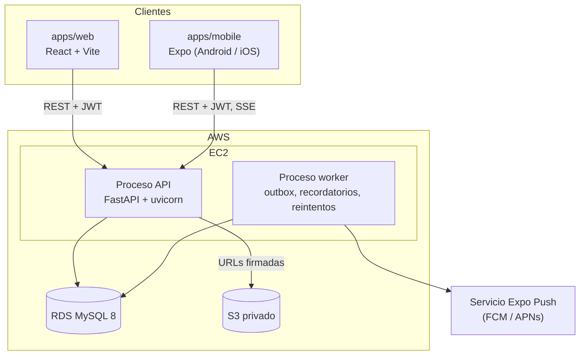
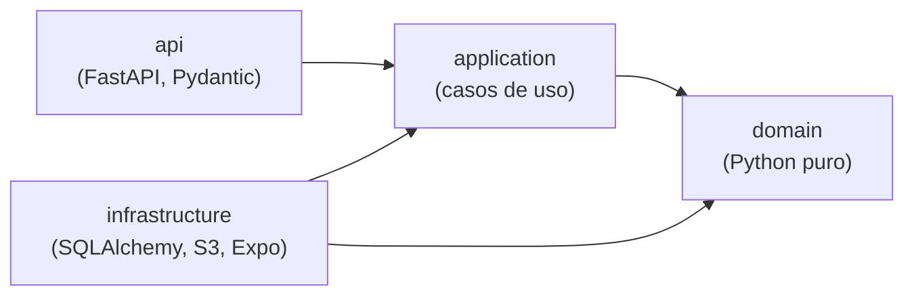

# Arquitectura general

> Estado: **diseño aprobado, sin implementar.** Las secciones describen el objetivo de las fases 1 a 3.

## Vista de despliegue



En local, `docker compose` levanta MySQL, la API y el worker; los archivos se guardan en disco
detrás del mismo puerto `FileStorage` que en producción usa S3.

## Monolito modular

Un solo código desplegable (`apps/api`) con dos procesos: la API HTTP y el worker. Cada
*bounded context* es un paquete con límites explícitos (ver [ADR 0001](../adr/0001-monolito-modular.md)).

```
apps/api/src/vetcare/
├── shared_kernel/      # Entity, ValueObject, DomainEvent, Clock, errores de dominio
├── platform/           # infraestructura transversal: db, outbox, auth, storage, sse, settings
├── contexts/
│   └── <contexto>/
│       ├── domain/         # agregados, VOs, eventos, servicios de dominio, puertos de repositorio
│       ├── application/    # casos de uso (comandos y consultas), DTOs, puertos de salida
│       ├── infrastructure/ # repositorios SQLAlchemy, mapeos, adaptadores
│       └── api/            # routers FastAPI y esquemas Pydantic (solo traducción HTTP)
├── main.py             # composición de la API
└── worker.py           # composición del worker
```

## Capas y reglas de dependencia



- `domain` no importa FastAPI, Pydantic, SQLAlchemy ni nada de `platform`.
- `application` define puertos (interfaces `Protocol`) que `infrastructure` implementa.
- Los routers validan la forma de la entrada, invocan un caso de uso y traducen el resultado.
  No contienen reglas de negocio.
- Un contexto solo importa de otro su módulo `public` (consultas y contratos publicados), nunca
  su dominio ni su infraestructura.
- Estas reglas se verifican con una prueba automática de imports en CI.

## Comunicación entre contextos

| Necesidad | Mecanismo |
|---|---|
| Consulta síncrona (¿puede este usuario ver esta mascota?) | Puerto público del contexto dueño del dato, p. ej. `PetAccessQuery` |
| Reacción a algo que ocurrió (cita confirmada → notificar) | Evento de dominio guardado en el **outbox** en la misma transacción ([ADR 0003](../adr/0003-outbox-transaccional.md)) |
| Tiempo real hacia el cliente | SSE alimentado desde el outbox ([ADR 0004](../adr/0004-sse-y-notificaciones-push.md)) |

## Transacciones y concurrencia

- Un caso de uso = una transacción (unidad de trabajo). El outbox se escribe dentro de ella.
- Los agregados con edición concurrente (seguimiento de servicios) usan **concurrencia optimista**
  con una columna `version`.
- Las reservas usan **bloqueo pesimista** sobre los recursos implicados (`SELECT … FOR UPDATE`)
  y una `Idempotency-Key` para reintentos del cliente. Ver [scheduling](../domain/flows.md#citas).
- Las fechas se guardan en UTC y se presentan en `America/Lima`.
- Aislamiento **READ COMMITTED** en todas las conexiones: cada lectura ve lo último confirmado.
  Con el REPEATABLE READ por defecto de MySQL, una transacción que esperó un bloqueo seguiría
  viendo la foto tomada antes de esperar (por ejemplo, no vería la cita que la otra acaba de
  confirmar). Las invariantes de concurrencia se protegen con bloqueos explícitos y versiones.

## Contratos entre backend y clientes

FastAPI publica OpenAPI. `packages/shared` genera desde ese documento los tipos TypeScript que
consumen la web y la app móvil. El CI falla si los tipos generados no coinciden con la API.
