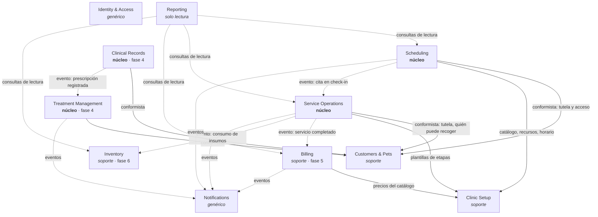

# Bounded contexts

> Estado: **diseño.** Los contextos de las fases 4 a 6 están definidos a nivel de responsabilidad
> y se detallarán al llegar a su fase.

## Mapa de contextos

Las flechas continuas son consultas síncronas por puertos públicos; las discontinuas, eventos
de dominio publicados por el outbox. Todos los contextos consultan a Identity & Access para
autorización (se omite en el diagrama).

## Responsabilidades

| Contexto | Responsable de | No es responsable de |
|---|---|---|
| **Identity & Access** | Cuentas, invitaciones, inicio de sesión, refresh tokens con rotación, recuperación de acceso, roles, permisos, registro de auditoría | Datos de contacto del cliente (Customers & Pets) |
| **Clinic Setup** | Catálogo de tipos de servicio (duración, recursos requeridos), plantillas de etapas de seguimiento, recursos agendables (profesionales, mesas de baño, quirófano), horario y feriados de la sede | Precios vigentes al cobrar (Billing toma una copia al generar el cargo) |
| **Customers & Pets** | Clientes, mascotas, datos básicos, alergias y observaciones, fotografía, **tutela** (dueños y responsables autorizados con permisos) | Expediente clínico |
| **Scheduling** | Disponibilidad, reservas, confirmación, reprogramación, cancelación, inasistencias, conflictos | Ejecución del servicio |
| **Service Operations** | Seguimiento por etapas de baños, peluquería, cirugías y hospitalización; historial de transiciones; actualizaciones publicadas al cliente; entrega de la mascota | Diagnósticos y prescripciones; cobro |
| **Clinical Records** | Consultas, evaluaciones, diagnósticos, prescripciones, vacunas, desparasitaciones, documentos clínicos y enmiendas trazables | Recordatorios de dosis |
| **Treatment Management** | Pautas a partir de una prescripción, dosis programadas, administración en clínica y declaraciones del dueño, incidencias | Calcular o modificar dosis (nunca) |
| **Billing** | Presupuestos, cargos, adelantos, pagos parciales, saldos, comprobantes internos | Estado del servicio; comprobantes electrónicos SUNAT |
| **Inventory** | Productos, lotes, vencimientos, movimientos de entrada y salida, stock mínimo | Precios de venta |
| **Notifications** | Intenciones de notificación a partir de eventos, preferencias, tokens de dispositivo, entregas, reintentos, deduplicación | Decidir el contenido clínico (solo textos genéricos) |
| **Reporting** | Indicadores del dashboard y reportes, solo lectura | Reglas de negocio |

## Decisiones sobre los límites

- **Clinic Setup** se agrega a la lista inicial porque agenda, seguimiento y facturación necesitan
  el mismo catálogo de servicios y recursos. Si queda dentro de Scheduling, Service Operations
  dependería de la agenda solo para leer plantillas.
- **Hospitalización** vive en Service Operations como otro tipo de servicio con su plantilla de
  etapas; no justifica un contexto propio en esta etapa.
- **Archivos** (fotos, documentos) no son un contexto: son un puerto de infraestructura
  `FileStorage`. Cada contexto decide quién puede ver sus archivos.
- **Tutela** pertenece a Customers & Pets y es la fuente única de la pregunta "¿esta persona
  tiene relación con esta mascota y qué puede hacer?". Ningún otro contexto replica esa regla.
