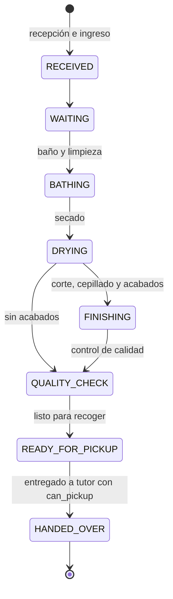
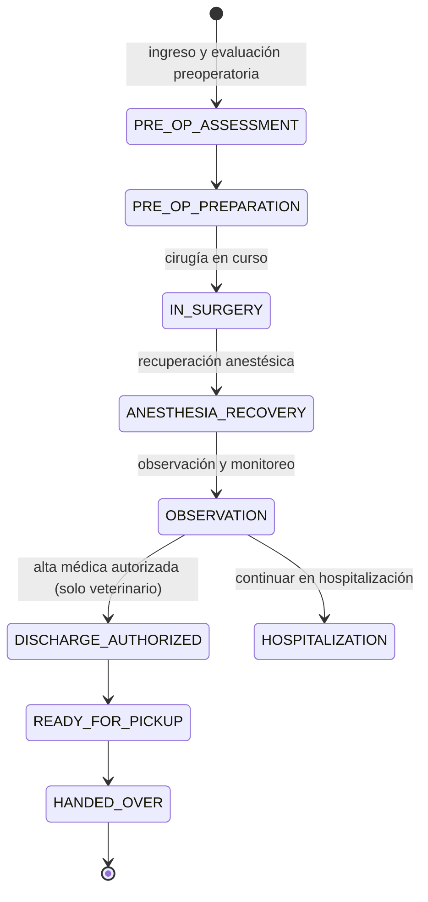
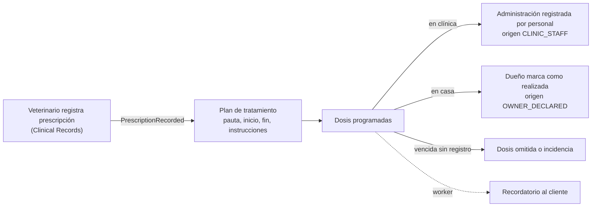
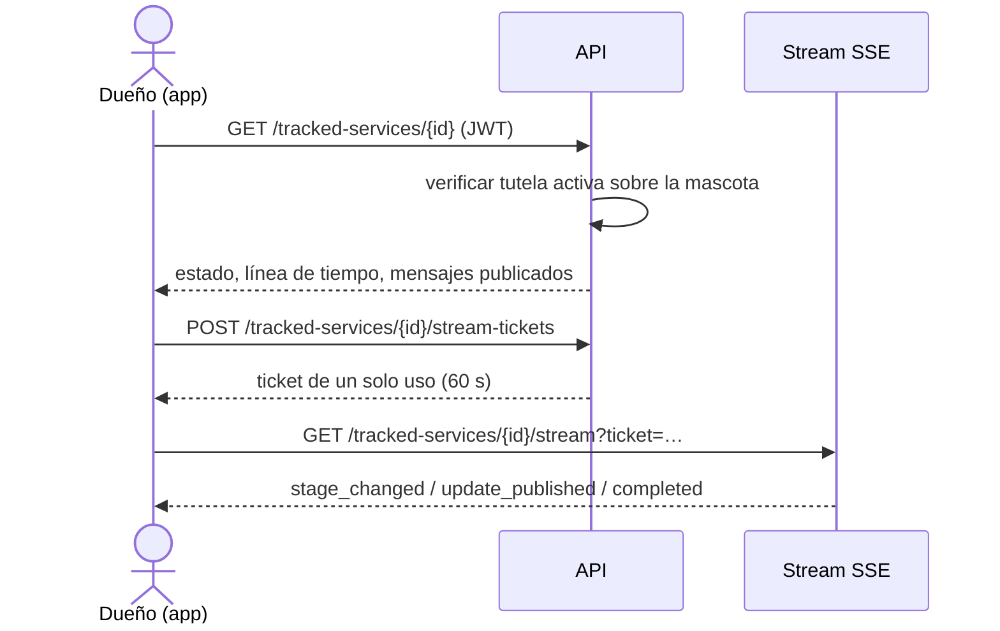

# Flujos principales

> Estado: **diseño.** Las plantillas de etapas son configurables en Clinic Setup; estas son las
> plantillas iniciales.

## Citas

```mermaid
sequenceDiagram
    actor C as Cliente (app) o recepción (web)
    participant API as Scheduling
    participant DB as MySQL
    participant W as Worker
    C->>API: POST /appointments (Idempotency-Key)
    API->>API: verificar permiso can_book o appointments:manage
    API->>DB: BEGIN; SELECT recursos FOR UPDATE
    API->>DB: buscar citas activas superpuestas
    alt hay conflicto
        API-->>C: 409 horario no disponible
    else libre
        API->>DB: INSERT cita + evento outbox; COMMIT
        API-->>C: 201 cita (REQUESTED o CONFIRMED)
        W->>DB: leer outbox
        W-->>C: push "solicitud recibida" / "cita confirmada"
    end
```

- Implementado (#25). La reserva bloquea con `SELECT … FOR UPDATE` una fila por recurso
  candidato (`sch_resource_locks`), siempre en el mismo orden, y recalcula la disponibilidad
  con lecturas de lo último confirmado.
- La disponibilidad se calcula y se valida **en el backend**. La web y la app solo muestran los
  huecos que devuelve la API.
- La `Idempotency-Key` evita reservas duplicadas por doble toque o reintentos de red: la misma
  clave con el mismo cuerpo devuelve la cita ya creada.
- El bloqueo por recurso serializa reservas concurrentes sobre el mismo profesional o mesa.
- Recordatorios (fase 3): el worker programará avisos (por defecto 24 h antes) sin enviar dos
  veces el mismo recordatorio para la misma cita.

## Baño y peluquería



Cada transición registra fecha, hora, usuario y nota opcional. El personal puede publicar
mensajes y fotos para el cliente en cualquier etapa. *Listo para recoger* envía un push.

## Cirugía



- `DISCHARGE_AUTHORIZED` requiere `tracking:authorize_discharge` (rol veterinario) y una acción
  explícita. No hay transiciones automáticas por tiempo.
- El cliente ve el nombre de la etapa y solo los mensajes que el personal redacta o selecciona.
  El sistema no genera frases como "la cirugía fue exitosa" o "la mascota está estable".
- La plantilla admite etapas adicionales por procedimiento.

## Tratamientos (fase 4)



La aplicación no recomienda, calcula ni modifica dosis. Una declaración del dueño nunca se
presenta como administración supervisada por la clínica.

## Seguimiento en la app del cliente


