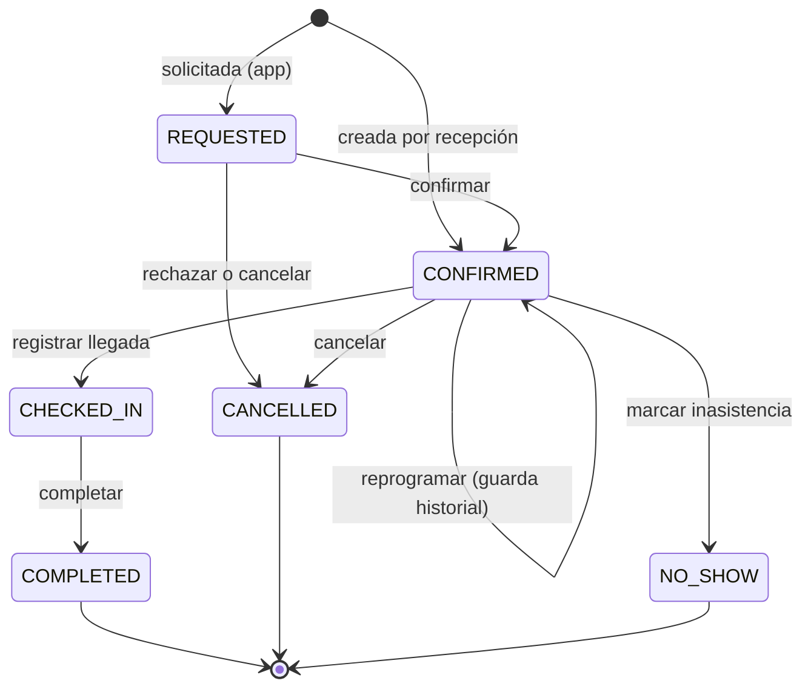

# Modelo de dominio inicial

> Estado: **diseño** para las fases 1 a 3. Los contextos de fases posteriores tienen un esbozo
> al final y se refinarán antes de implementarse.

## Identity & Access

| Elemento | Tipo | Notas |
|---|---|---|
| `UserAccount` | Agregado | email (VO, único), hash de contraseña argon2, roles, estado (`invited`, `active`, `disabled`), último acceso |
| `Invitation` | Agregado | token de un solo uso con expiración; al aceptarla se fija la contraseña y se activa la cuenta |
| `RefreshTokenFamily` | Agregado | cada refresh emite un token nuevo y revoca el anterior; reutilizar un token revocado revoca toda la familia |
| `PasswordResetRequest` | Agregado | token de un solo uso, expiración corta; la respuesta pública no revela si el correo existe |
| `Permission` | VO | constante en código, p. ej. `pets:read`, `appointments:manage`, `tracking:advance`, `tracking:authorize_discharge` |
| `Role` | VO | `ADMIN`, `VETERINARIAN`, `ASSISTANT`, `RECEPTIONIST`, `CLIENT`, cada uno con una lista explícita de permisos |
| `AuditEntry` | Registro solo de agregado | actor, acción, recurso, momento, IP; nunca contraseñas ni tokens |

## Clinic Setup

| Elemento | Tipo | Notas |
|---|---|---|
| `ServiceType` | Agregado | código, nombre, categoría (`consultation`, `vaccination`, `grooming`, `surgery`, `hospitalization`…), duración estimada, recursos requeridos, plantilla de seguimiento opcional, visible para reserva desde la app |
| `StageTemplate` | Agregado | etapas ordenadas, transiciones permitidas, etapas opcionales, etapas que requieren un permiso específico, etapa de entrega |
| `Resource` | Agregado | profesional (vinculado a un `UserAccount`), mesa, quirófano; horario laboral y bloqueos |
| `ClinicCalendar` | Agregado | horario de atención y feriados de la sede |

## Customers & Pets

| Elemento | Tipo | Notas |
|---|---|---|
| `Client` | Agregado | nombres, documento (VO DNI/CE), teléfono, email, dirección, cuenta vinculada opcional |
| `Pet` | Agregado | nombre, especie, raza, sexo, fecha de nacimiento (exacta o aproximada), foto, alergias, observaciones, estado (`active`, `deceased`, `transferred`) |
| `WeightRecord` | Entidad de `Pet` | peso en kg (VO), fecha, quién lo registró |
| `Guardianship` | Entidad de `Pet` | cliente, tipo (`OWNER`, `AUTHORIZED`), permisos `can_pickup`, `can_book`, `can_view_clinical`, vigencia |

Invariantes de `Pet`:

- Siempre tiene al menos un tutor `OWNER` activo.
- Un cliente no tiene dos tutelas activas sobre la misma mascota.
- Solo un `OWNER` o el personal puede agregar o revocar responsables autorizados.

## Scheduling

| Elemento | Tipo | Notas |
|---|---|---|
| `Appointment` | Agregado | mascota, cliente que reserva, tipo de servicio, `TimeSlot`, recursos asignados, motivo, observaciones, estado, historial de cambios |
| `TimeSlot` | VO | inicio y fin en UTC; se presenta en `America/Lima`; fin > inicio |
| `AvailabilityPolicy` | Servicio de dominio | calcula huecos libres según horario de la sede, horario y bloqueos de los recursos y citas existentes |

Estados de la cita:

Invariantes: no hay dos citas activas que se superpongan sobre el mismo recurso; un cliente solo
reserva para mascotas donde tiene `can_book`; reprogramar y cancelar desde la app respetan la
antelación mínima configurada.

## Service Operations

| Elemento | Tipo | Notas |
|---|---|---|
| `TrackedService` | Agregado | tipo de servicio, mascota, cita de origen (opcional para ingresos sin cita), copia de la plantilla de etapas, etapa actual, responsables, `version` |
| `StageTransition` | Entidad (solo agregado) | etapa origen y destino, momento, usuario, nota interna |
| `ClientUpdate` | Entidad | texto redactado o seleccionado por el personal, adjuntos autorizados, autor, momento de publicación |
| `Handover` | VO | quién recogió (tutor con `can_pickup`), quién entregó, momento |
| `Attachment` | VO | referencia a archivo, visibilidad (`internal` o `client`) |

Invariantes de `TrackedService`:

- Solo se avanza por transiciones definidas en la plantilla; las etapas opcionales se pueden
  saltar, las obligatorias no.
- Las etapas marcadas como clínicas (p. ej. *alta médica autorizada*) exigen el permiso
  `tracking:authorize_discharge` y una acción explícita del veterinario. **El sistema nunca
  avanza a esas etapas de forma automática** ni genera textos sobre el estado de salud.
- Lo que ve el cliente es solo lo publicado como `ClientUpdate` y el nombre de la etapa.
- La entrega exige un tutor activo con `can_pickup`.
- Un servicio entregado o cancelado no admite cambios.
- Dos actualizaciones simultáneas sobre la misma versión: la segunda falla con conflicto.

## Eventos de dominio (fases 1 a 3)

| Evento | Origen | Consumidores |
|---|---|---|
| `InvitationIssued` | Identity | Notifications (correo) |
| `AppointmentRequested`, `AppointmentConfirmed`, `AppointmentRescheduled`, `AppointmentCancelled`, `AppointmentMarkedNoShow` | Scheduling | Notifications |
| `AppointmentCheckedIn` | Scheduling | Service Operations (crea el seguimiento si el servicio tiene plantilla) |
| `ServiceStarted`, `StageAdvanced` | Service Operations | SSE, Notifications (solo hitos configurados) |
| `ClientUpdatePublished` | Service Operations | SSE, Notifications |
| `DischargeAuthorized`, `ReadyForPickup`, `PetHandedOver` | Service Operations | SSE, Notifications, Billing (fase 5) |

## Esbozo de fases posteriores

- **Clinical Records**: `MedicalRecord` por mascota; `Encounter` (consulta) con evaluación,
  diagnósticos y prescripciones; `VaccinationRecord`, `DewormingRecord`, `ClinicalDocument` con
  visibilidad para el cliente. Los registros no se borran: se corrigen con una `Amendment` que
  referencia al original y guarda autor y motivo.
- **Treatment Management**: `TreatmentPlan` creado desde una prescripción (la dosis es el texto
  prescrito, el sistema no la calcula); `ScheduledDose`; `AdministrationRecord` con origen
  `CLINIC_STAFF` u `OWNER_DECLARED` y resultado `given`, `missed` o `incident`.
- **Billing**: `Money` en céntimos de PEN; `Quote`, `ClientAccount` (cargos y abonos), `Payment`
  con método registrado manualmente, `InternalReceipt` con numeración propia.
- **Inventory**: `Product`, `Lot` con vencimiento, `StockMovement` solo de agregado; el stock por
  lote nunca es negativo.
