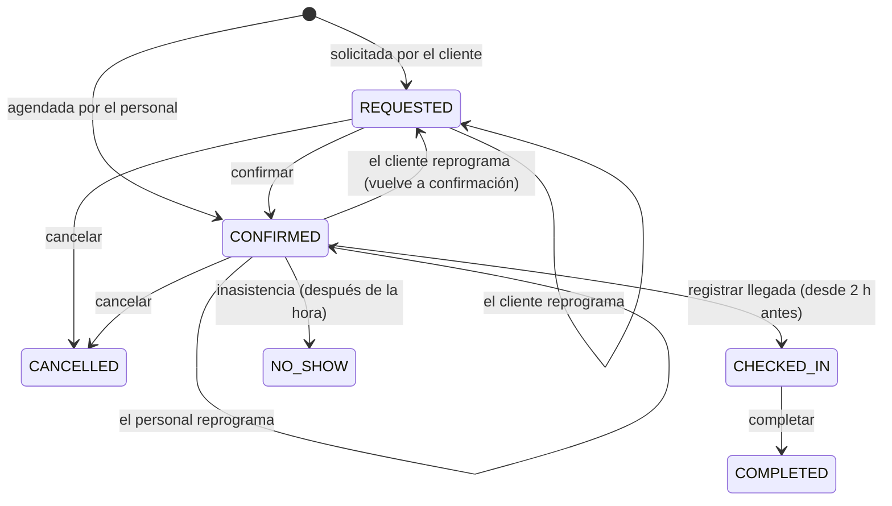

# Modelo de dominio inicial

> Estado: **diseño** para las fases 1 a 3. Los contextos de fases posteriores tienen un esbozo
> al final y se refinarán antes de implementarse.

## Identity & Access

| Elemento | Tipo | Notas |
|---|---|---|
| `UserAccount` | Agregado | email (VO, único), hash de contraseña argon2, roles, estado (`invited`, `active`, `disabled`), último acceso |
| `Invitation` | Agregado | token de un solo uso con expiración; al aceptarla se fija la contraseña y se activa la cuenta |
| `RefreshTokenFamily` | Agregado | cada refresh emite un token nuevo y revoca el anterior; reutilizar un token revocado revoca toda la familia |
| `PasswordResetRequest` | Agregado | token de un solo uso, expiración corta; la respuesta pública no revela si el correo existe |
| `Permission` | VO | constante en código, p. ej. `pets:read`, `appointments:manage`, `tracking:advance`, `tracking:authorize_discharge` |
| `Role` | VO | `ADMIN`, `VETERINARIAN`, `ASSISTANT`, `RECEPTIONIST`, `CLIENT`, cada uno con una lista explícita de permisos |
| `AuditEntry` | Registro solo de agregado | actor, acción, recurso, momento, IP; nunca contraseñas ni tokens |

## Clinic Setup

> Implementado (#20), salvo `StageTemplate`, que llega con Service Operations en la fase 3.

| Elemento | Tipo | Notas |
|---|---|---|
| `ServiceType` | Agregado | `ServiceCode` (único, estable), nombre, categoría (`consultation`, `vaccination`, `grooming`, `surgery`, `hospitalization`, `other`), `Duration` (5 a 600 min, múltiplos de 5), recursos requeridos (al menos uno), reservable por el cliente, activo |
| `Resource` | Agregado | tipo (`veterinarian`, `groomer`, `consultation_room`, `grooming_station`, `operating_room`), nombre, cuenta vinculada (solo profesionales), horario semanal, bloqueos (`TimeOff`, en UTC, sin superponerse), activo |
| `ClinicCalendar` | Agregado | horario de atención semanal y feriados de la sede (una sola fila) |
| `WeeklySchedule`, `TimeRange` | VO | franjas por día en hora local de America/Lima, en múltiplos de 5 min, sin superponerse ni cruzar la medianoche |
| `StageTemplate` | Agregado (fase 3) | etapas ordenadas, transiciones permitidas, etapas opcionales, etapas que requieren un permiso específico, etapa de entrega |

Reglas de disponibilidad que usa la agenda (contrato público `ClinicCatalog`):

- La sede atiende en `[inicio, fin)` si el día local no es feriado y el intervalo cabe completo en
  una franja del horario de atención.
- Un recurso está disponible si está activo, el intervalo cabe en su horario semanal y no se
  cruza con ningún bloqueo. Que no tenga otra cita lo verifica Scheduling.

## Customers & Pets

> Implementado (#22). Las fotos llegan con #23.

| Elemento | Tipo | Notas |
|---|---|---|
| `Client` | Agregado | nombre, `IdentityDocument` (DNI de 8 dígitos, CE o pasaporte; único), `PhoneNumber` (celular peruano o internacional, normalizado a +51…), `ContactEmail` opcional (único), dirección, notas, cuenta vinculada opcional |
| `Pet` | Agregado | nombre, especie, sexo, raza, `BirthDate` exacta o aproximada (no futura), color, alergias, notas internas, estado (`active`, `deceased`, `transferred`), historial de pesos |
| `WeightRecord` | Entidad de `Pet` | kg (0.01 a 200, dos decimales), momento, quién lo registró |
| `Guardianship` | Entidad de `Pet` | cliente, tipo (`OWNER`, `AUTHORIZED`), permisos `can_pickup`, `can_book`, `can_view_clinical`, desde, revocada en (se conserva el historial) |

Invariantes de `Pet`:

- Siempre tiene al menos un dueño activo: no se puede revocar ni degradar al último.
- Un cliente no tiene dos tutelas activas sobre la misma mascota.
- Un dueño tiene siempre todos los permisos.
- No se reserva para una mascota que no está activa.

Acceso (fuente única: contrato público `PetAccess`):

| Acción | Permite |
|---|---|
| `view` | cualquier tutela activa |
| `book` | `can_book` y mascota activa |
| `pickup` | `can_pickup` |
| `view_clinical` | `can_view_clinical` |

Lo que ve un cliente de su mascota: nunca las notas internas, y las alergias solo con
`view_clinical`. Una mascota ajena responde 404, igual que una inexistente.

Con cuenta vinculada, el correo del cliente se cambia desde la cuenta, no desde la ficha.

## Scheduling

> Implementado (#25). Los recordatorios llegan con el worker de notificaciones (fase 3).

| Elemento | Tipo | Notas |
|---|---|---|
| `Appointment` | Agregado | mascota, responsable que reserva, servicio (nombre copiado al reservar), `TimeSlot`, recursos asignados, canal (`staff` o `client`), motivo, notas internas, estado, historial |
| `TimeSlot` | VO | `[inicio, fin)` en UTC; dos franjas que solo se tocan no se superponen |
| `HistoryEntry` | Entidad (solo agregado) | acción, quién, cuándo y la franja vigente en ese momento |
| `SchedulingPolicy` | VO | paso de la agenda (15 min), antelación mínima del cliente para reservar (30 min) y para cambiar o cancelar una cita confirmada (2 h) |
| `Availability` | Servicio de dominio | por cada tipo de recurso requerido busca uno libre (horario propio, sin bloqueos, sin citas activas) con la sede abierta |

Estados de la cita:

Invariantes:

- Ningún recurso tiene dos citas activas (`requested`, `confirmed`, `checked_in`) superpuestas.
- La cita cabe en el horario de la sede (sin feriado) y en el horario de cada recurso asignado.
- El cliente solo reserva para mascotas donde su tutela permite `book`, servicios reservables y
  con la antelación mínima; reprograma o cancela una cita confirmada con al menos 2 h.
- Una cita cancelada, completada o con inasistencia ya no cambia.

## Service Operations

| Elemento | Tipo | Notas |
|---|---|---|
| `TrackedService` | Agregado | tipo de servicio, mascota, cita de origen (opcional para ingresos sin cita), copia de la plantilla de etapas, etapa actual, responsables, `version` |
| `StageTransition` | Entidad (solo agregado) | etapa origen y destino, momento, usuario, nota interna |
| `ClientUpdate` | Entidad | texto redactado o seleccionado por el personal, adjuntos autorizados, autor, momento de publicación |
| `Handover` | VO | quién recogió (tutor con `can_pickup`), quién entregó, momento |
| `Attachment` | VO | referencia a archivo, visibilidad (`internal` o `client`) |

Invariantes de `TrackedService`:

- Solo se avanza por transiciones definidas en la plantilla; las etapas opcionales se pueden
  saltar, las obligatorias no.
- Las etapas marcadas como clínicas (p. ej. *alta médica autorizada*) exigen el permiso
  `tracking:authorize_discharge` y una acción explícita del veterinario. **El sistema nunca
  avanza a esas etapas de forma automática** ni genera textos sobre el estado de salud.
- Lo que ve el cliente es solo lo publicado como `ClientUpdate` y el nombre de la etapa.
- La entrega exige un tutor activo con `can_pickup`.
- Un servicio entregado o cancelado no admite cambios.
- Dos actualizaciones simultáneas sobre la misma versión: la segunda falla con conflicto.

## Eventos de dominio (fases 1 a 3)

| Evento | Origen | Consumidores |
|---|---|---|
| `InvitationIssued` | Identity | Notifications (correo) |
| `AppointmentRequested`, `AppointmentConfirmed`, `AppointmentRescheduled`, `AppointmentCancelled`, `AppointmentMarkedNoShow` | Scheduling | Notifications |
| `AppointmentCheckedIn` | Scheduling | Service Operations (crea el seguimiento si el servicio tiene plantilla) |
| `ServiceStarted`, `StageAdvanced` | Service Operations | SSE, Notifications (solo hitos configurados) |
| `ClientUpdatePublished` | Service Operations | SSE, Notifications |
| `DischargeAuthorized`, `ReadyForPickup`, `PetHandedOver` | Service Operations | SSE, Notifications, Billing (fase 5) |

## Esbozo de fases posteriores

- **Clinical Records**: `MedicalRecord` por mascota; `Encounter` (consulta) con evaluación,
  diagnósticos y prescripciones; `VaccinationRecord`, `DewormingRecord`, `ClinicalDocument` con
  visibilidad para el cliente. Los registros no se borran: se corrigen con una `Amendment` que
  referencia al original y guarda autor y motivo.
- **Treatment Management**: `TreatmentPlan` creado desde una prescripción (la dosis es el texto
  prescrito, el sistema no la calcula); `ScheduledDose`; `AdministrationRecord` con origen
  `CLINIC_STAFF` u `OWNER_DECLARED` y resultado `given`, `missed` o `incident`.
- **Billing**: `Money` en céntimos de PEN; `Quote`, `ClientAccount` (cargos y abonos), `Payment`
  con método registrado manualmente, `InternalReceipt` con numeración propia.
- **Inventory**: `Product`, `Lot` con vencimiento, `StockMovement` solo de agregado; el stock por
  lote nunca es negativo.
